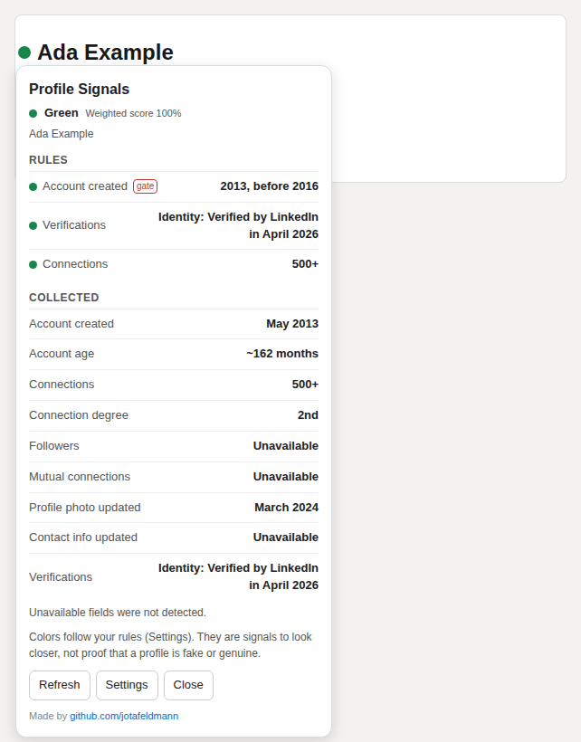
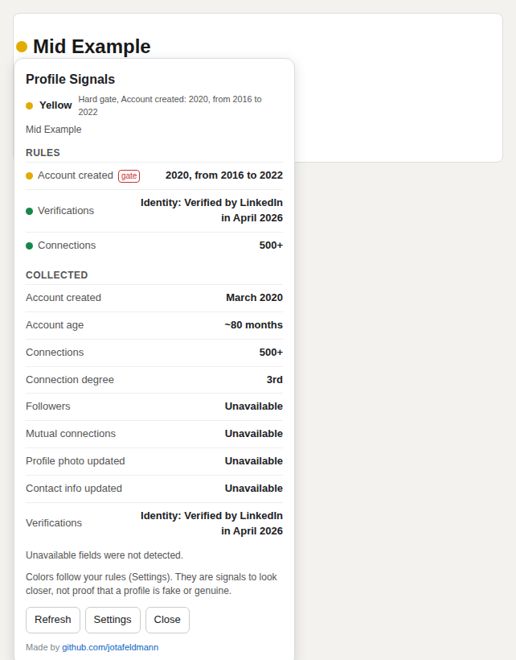
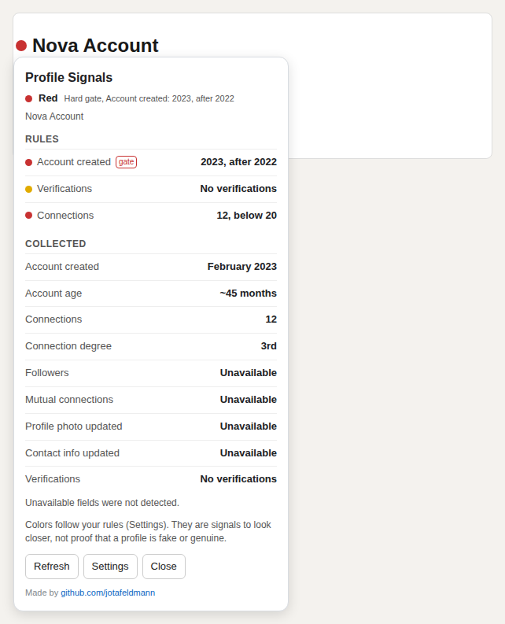
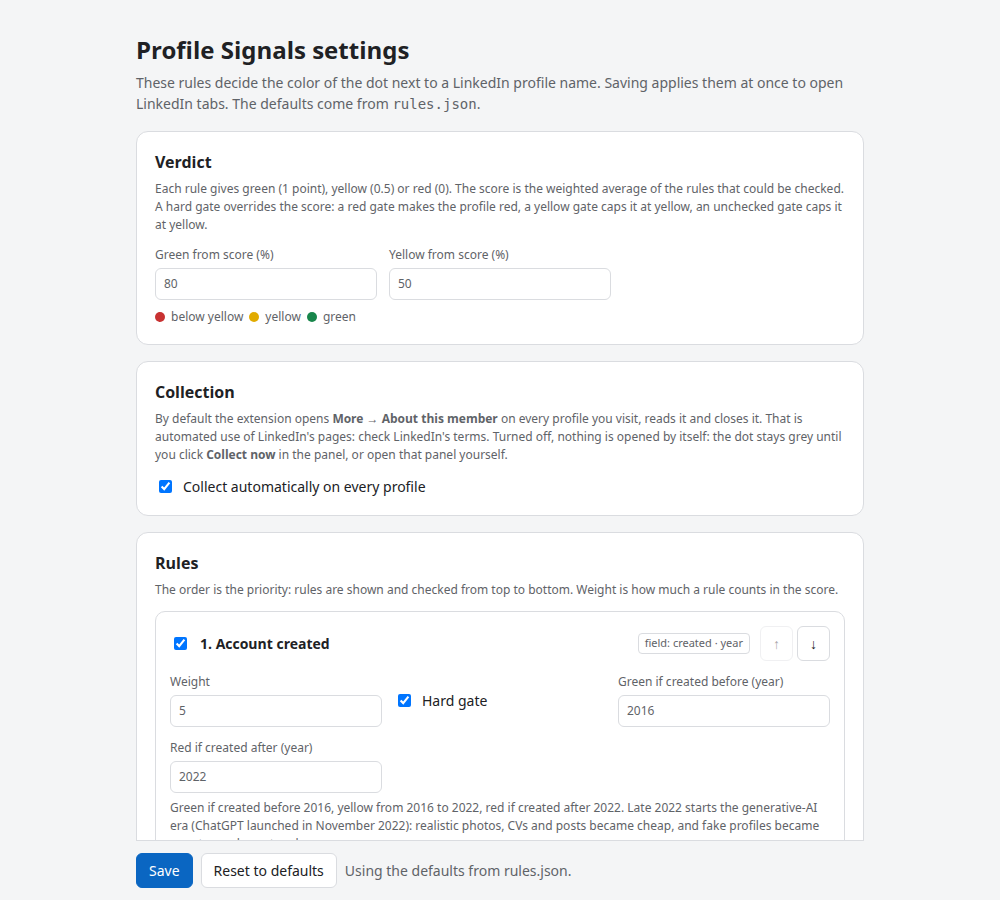

# Profile Signals

[](https://github.com/jotafeldmann/profile-signals/actions/workflows/ci.yml)

<p>
  
  
  
</p>

A Chrome extension that reads what LinkedIn already shows about a member profile (account creation date,
verifications, connections) and rates it green, yellow or red with rules you set. No account, no AI, no
server: everything runs and stays in your browser (the only request is a daily check for a new version on
GitHub).

**The colors are signals to look closer, not proof.** A new account does not make a profile fake, and a
green one may still be fake. Do not use them alone for hiring or any other decision about a person.

## Install

1. Download `profile-signals-<version>.zip` from the
   [latest release](https://github.com/jotafeldmann/profile-signals/releases/latest) and extract it.
2. Open `chrome://extensions`, turn on **Developer mode**, click **Load unpacked** and pick the extracted
   `profile-signals` folder (the one with `manifest.json`).
3. Pin the extension from the puzzle icon, then open or reload a LinkedIn profile.

**Updating.** When a new version is out, a red badge appears on the extension's icon and the panel opens
with *There is an update for the extension · Update now*. Download the new zip from the
[latest release](https://github.com/jotafeldmann/profile-signals/releases/latest), replace the folder's files
with it, click reload on the extension in `chrome://extensions`, then reload LinkedIn.

## Use

- On a profile (`https://www.linkedin.com/in/...`) a dot floats to the left of the name. The extension opens
  **More → About this member** by itself, reads it and closes it: the dot turns **green**, **yellow** or
  **red**, and clicking it shows why, rule by rule.
- **Settings** in the panel changes the rules, their weights and hard gates, the cache, and whether to
  collect automatically (on by default: see [privacy and limits](docs/privacy.md)). Turned off, the dot stays
  grey until you click it and choose **Collect now**, or open the About panel yourself.
- 🕘 on the dot means the result came from the cache; **Refresh now** collects again.
- A grey **?** means LinkedIn did not open the About panel in time (it is given about half a minute):
  **Try again**, or open **More → About this member** yourself.

## Develop

Needs nvm, and Docker for the visual tests. Then:

```bash
make install
```

```bash
make ci
```

`make` lists every command. `make start` opens Chromium with the extension on synthetic profiles; the
tests never reach LinkedIn.

## Configure

Everything that decides the color is a setting: **Settings** in the panel, or right-click the toolbar icon,
**Options**. Saved settings apply at once to open LinkedIn tabs, and **Reset to defaults** goes back to
[`rules.json`](extension/rules.json).



- **Hard gates:** turn any rule into a gate, or stop it being one. A red gate makes the profile red, a yellow
  gate caps it at yellow. By default only **Account created** is a gate.
- **Rules:** turn each one on or off, reorder them (the order is the priority), set its weight and its
  limits (the years, the connection counts, the color when nothing is shown).
- **Verdict:** the score from which a profile is green (80%) or yellow (50%).
- **Collection:** automatic on every profile (default) or only when you click.
- **Cache:** on or off, and how many days a result is kept (90).
- **Share with your team:** download your settings as a file, or copy them, and send them; a teammate loads
  the file or pastes the text, reviews it and saves. Only the verdict and the rules travel. An example:
  [worst signal wins](docs/examples/worst-signal-wins.json).

The rules and their defaults, with the reasons: [rules](docs/rules.md). The profiles in these images are
invented, as in the tests.

## Docs

- [Getting started](docs/getting-started.md): first run, tests, releasing a version
- [Rules](docs/rules.md): how the color is decided, the defaults, the cache
- [Privacy and limits](docs/privacy.md)
- [How it works](docs/how-it-works.md): the files, the collection steps, what breaks when LinkedIn changes
- [Decisions](docs/decisions/README.md)
- [HANDOFF.md](HANDOFF.md): what is left to do

License: [MIT](LICENSE).

Made by [jotafeldmann](https://github.com/jotafeldmann). Not affiliated with LinkedIn.
